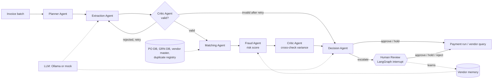

# Invoice Three-Way Match Agents

A multi-agent accounts-payable workflow. Before paying a vendor invoice, finance teams must check it
against the **purchase order** (what was ordered) and the **goods receipt note** (what arrived).
Doing this by hand is slow and error-prone, so duplicates and overpayments slip through.
This PoC shows how cooperating agents plan, extract, validate, match, detect fraud and decide, with a
human in the loop for risky invoices and a vendor memory that learns from every decision. Synthetic data only.

**Team:** Swastik Gavhane (PRN 24070126224) and Saafalya Sengupta (PRN 24070126158), Symbiosis Institute of Technology.

## What's new in this version

- **Fraud Agent:** catches fraud a three-way match cannot see: lookalike vendor names ("Acme Suplies"),
  bank-account changes, amount spikes against the vendor's history, and suspiciously round totals.
  Every invoice gets a 0-100 risk score with the reasons behind each point.
- **Human in the loop:** escalated invoices pause at a LangGraph `interrupt` with a checkpointer. A reviewer
  approves, holds or rejects in the Review queue tab (or the CLI with `--hitl`), and the graph resumes.
  Every decision lands in an audit trail.
- **Vendor memory:** long-term memory per vendor (approved history, bank on file, escalations, overrides).
  The Fraud Agent reads it, the reviewer's decisions write to it, so the system learns. Example: approve a
  bank change once, and that vendor's next invoice to the new account is not flagged.
- **PDF upload:** run the agents on real PDF invoices. Download a sample PDF from the app to try it;
  re-uploading an invoice that was already processed is caught as a duplicate.
- **Ollama in more agents:** the Fraud Agent writes a plain-language risk note (numbers it invents are
  rejected), and the Critic gets a second opinion from the model. The Critic also checks every key field
  appears in the document. A model's doubt triggers a retry but never escalates an invoice on its own.
- **Tests:** `pytest` runs 20 end-to-end checks of the pipeline, fraud rules, pause/resume and PDF handling.

## Run it

```bash
python -m venv .venv && source .venv/bin/activate      # Windows: .venv\Scripts\activate
pip install -r requirements.txt
streamlit run app.py
```

No LLM is needed: the default **Mock** backend is rule-based. To use a local model:

```bash
ollama pull llama3.2        # or qwen2.5:3b on a low-RAM laptop
```
then pick "Ollama (local model)" in the sidebar.
Not sure your laptop can run it? `python check_ollama.py` shows your RAM, whether Ollama is running,
which models you have, and which model to use. If Ollama is unreachable the app falls back to the mock.

Headless check (no UI): `python run_cli.py --verbose` (add `--ollama llama3.2` to use a model,
`--hitl` to review escalations yourself, `--memory vendor_memory.json` to keep the vendor memory).

Tests: `pytest`

## Agents and workflow



| Agent | What it does |
|---|---|
| Planner | Sequences the batch by due date, then amount; marks invoices due within 7 days as urgent |
| Extraction | Parses invoice text into a Pydantic schema (LLM if available, otherwise a fast parser) |
| Critic | Rejects extractions whose arithmetic fails and triggers a retry; later checks every money variance is explained |
| Matching | Invoice vs PO vs GRN: price, quantity received, tax rate, vendor, duplicates |
| Fraud | Lookalike vendor, bank change, amount spike, round amount, vendor track record; 0-100 risk score |
| Decision | Applies rules, then writes a plain-language reason |
| Human Review | Pauses escalations for a person (LangGraph `interrupt`), resumes with their answer, updates memory |

**Decision rules** (`tools.decide`): no issues means approved. Duplicate, unknown or lookalike vendor, bank
change, missing PO, vendor mismatch or unexplained variance means escalated. A fraud risk score of 40 or more
means escalated. Other mismatches are held for vendor correction, or escalated when the amount at risk is
10,000 INR or more (`config.py`). Escalated invoices wait for a human to approve, hold or reject.

**The Critic loop is real.** About 40% of generated invoices use thousand separators (`1,250.00`). The fast
parser misreads them, the Critic notices the arithmetic no longer adds up, and the Extraction Agent retries
with the robust parser. Watch for "REJECTED ... retry" lines in the live trace.

## Files

| File | Purpose |
|---|---|
| `app.py` | Streamlit UI: run agents, live trace, results, architecture |
| `orchestrator.py` | LangGraph graph with checkpointer (plus a plain-Python fallback), pause/resume, batch runner, evaluation |
| `agents.py` | The agents, including Fraud and Human Review |
| `tools.py` | Parsing, validation, three-way match, fraud checks, decision rules |
| `memory.py` | Long-term vendor memory (JSON) |
| `pdf_tools.py` | Read uploaded PDF invoices; render sample invoice PDFs |
| `tests/` | `pytest` end-to-end tests |
| `data_gen.py` | Synthetic vendors, POs, GRNs and invoices with seeded errors and an answer key |
| `llm.py` | Mock and Ollama backends |
| `schemas.py`, `config.py` | Data models and thresholds |
| `run_cli.py` | Headless run with metrics |

## Seeded errors and validation

The generator injects: price mismatch, billed quantity above goods received, duplicate invoice, unknown
vendor (with a non-existent PO), wrong tax rate, and three fraud patterns: a lookalike vendor reusing a real
PO, a changed pay-to bank account, and an amount far above the vendor's history. Because the answer key is known, the Results tab reports
errors caught, correct issue type, false positives, retries recovered, fraud cases escalated, human reviews
and overrides, and amount at risk detected vs true.

On the default batch (24 invoices, seed 42) the agents catch 8/8 seeded errors, including 3/3 fraud cases,
with 0/16 false alarms. Across 37,200 generated invoices (300 seeds, three batch sizes) 99.98% are decided
correctly; the misses are rare amount-spike edge cases.

## Limitations

- Synthetic data and a fixed invoice layout. The parser would not survive real vendor formats.
- Matching is deterministic by design, so scores on this data are high. That shows the pipeline works,
  not that it would score the same on messy real invoices. With a small Ollama model, extraction errors are
  expected and the Critic loop is what catches them.
- Time savings use assumptions you set in the sidebar. They are estimates, not measurements.
- PDF upload reads text PDFs; scanned images need OCR, which is not built in. With the mock backend only
  this demo layout parses; other layouts need the Ollama backend.
- The review queue has no login, so "reviewer" is just a name typed in the sidebar.
- No ERP integration.

## Future scope

OCR for scanned PDFs and photos, ERP connectors (SAP, Tally), role-based approval limits with login,
learning the fraud weights from reviewer decisions, and MCP-exposed tools for PO lookup.
